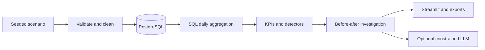
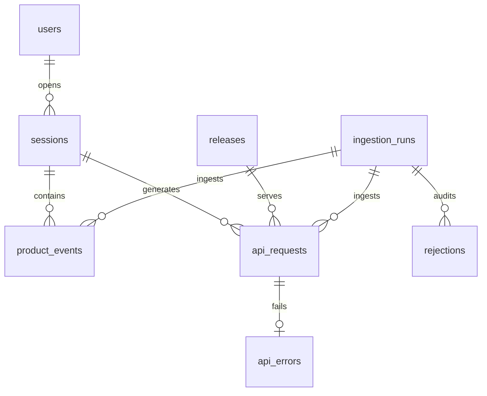

# Product KPI & Incident Intelligence

A product analyst workspace that turns **entirely synthetic SaaS telemetry** into
engagement, conversion, retention and reliability evidence. Investigate changes without
confusing a nearby release with proof of causation. No real customers or business outcomes.

## Quick start

Python 3.12+, no paid services or API keys:

```bash
python -m venv .venv
# Windows: .venv\Scripts\activate
# macOS/Linux: source .venv/bin/activate
pip install -e '.[dev]'
alembic upgrade head
python -m product.pipeline
streamlit run app/dashboard.py --server.port 8502
```

Visit http://localhost:8502; select January 1–March 31, 2025. Offline mode uses SQLite.
For the PostgreSQL deployment:

```bash
docker compose up --build
```

Compose migrates, loads the seed and launches Streamlit on localhost:8502. PostgreSQL binds
to localhost:5434, persists in a named volume and waits for its readiness check.
`docker compose down` preserves data. Set `POSTGRES_PASSWORD` in an untracked `.env` to
replace the local demonstration password; percent-encode reserved characters in database URLs.

## Features and stack

- Reproducible users, sessions, events, API requests/errors, releases and incidents.
- Timestamp/schema/reference/duplicate/transition validation, raw rejection evidence and run audits.
- Transactional bulk upserts and optional scenario replacement with audit preservation.
- SQL daily reliability; DAU/WAU/MAU, stickiness, feature adoption and usage frequency.
- Ordered seven-day activation funnels, mature-cohort conversion and weekly retention.
- Latency p50/p95/p99, endpoint failures, incident records and failed-request evidence.
- Past-only Z-score/MAD and baseline-trained Isolation Forest; labeled precision/recall/FP counts.
- Six Streamlit sections with dates, segments and anomaly metric/endpoint/feature/severity filters.
- CSV, JSON and HTML exports; deterministic reporting and constrained optional AI integration.
- PostgreSQL, SQLAlchemy, Alembic, Pandas, NumPy, Scikit-learn, Plotly, Streamlit, Pytest and Ruff.

## Architecture and schema





Incidents supply evaluation intervals. `src/product` separates generation, validation, persistence,
pipeline, services, analytics, detection, investigation and reporting. See
[architecture](docs/architecture.md), [schema](docs/data_model.md), [KPI definitions](docs/analytics.md),
[demo walkthrough](docs/demo_walkthrough.md), [interview guide](docs/interview_guide.md) and
[verification evidence](docs/verification.md).

## Provenance and regeneration

All identifiers and operational records are synthetic. `data/samples/scenario.json` records the
seed and interval. The 90-day seed-42 scenario includes growing activity, declining export usage,
report errors March 2–8, lower activation probability during that interval, and recovery March 9.
These are simulation inputs. Releases supply association evidence, not a causal experiment.

Rerunning seed 42 upserts stable IDs. To change seeds, replace old telemetry atomically:

```bash
python -m product.pipeline --seed 7 --replace
```

Replacement deletes scenario tables inside a transaction and preserves run/rejection audits.
The UI regenerate button uses replacement. The generator supports 1–90 days programmatically;
short runs may not reach the fixed scenario's incident interval.

## Analytical conventions

UTC windows use inclusive start/exclusive end; the UI includes the final selected date. DAU/WAU/MAU
count distinct users over trailing 1/7/30 days, not calendar months. Adoption divides feature users
by active users; frequency divides feature events by feature users. Missing denominators show NA.

Conversion requires a fully observed seven-day signup horizon and chronological register/login/
dashboard/activate events. Retention uses Monday registration cohorts and complete cohort weeks.
Returning percentage counts active users with accepted activity before the window. Error rate is
status >=400 requests / all requests; latency quantiles use all requests and linear interpolation.
See [definitions, formulas and edge cases](docs/analytics.md).

## Optional AI reporting

Set `OPENAI_API_KEY` and optionally `OPENAI_MODEL` (default `gpt-4.1-mini`, subject to account
availability), enable the checkbox and click Generate. Without a key reporting is deterministic.
The implementation uses [official structured outputs](https://developers.openai.com/api/docs/guides/structured-outputs?api-mode=chat).
The model selects existing evidence IDs and approved hypotheses/investigations only. Numerical
facts are rendered from computations. Raw log messages, descriptions and properties are excluded.
Local validation rejects invented references, extra keys and malformed responses; failures fall
back without logging credentials. No model SQL execution or unrestricted function calls exist.
This deliberately limits prose generation. See verification for live versus mocked API checks.

## Configuration and tests

- `DATABASE_URL`: default `sqlite:///product.db`; accepts PostgreSQL SQLAlchemy URLs.
- `TEST_DATABASE_URL`: **disposable** PostgreSQL integration database; fixtures create/drop tables.
- `POSTGRES_PASSWORD`: Compose credential, local-demo-only by default.
- `OPENAI_API_KEY`, `OPENAI_MODEL`: optional; never commit real credentials.

```bash
ruff check .
ruff format --check .
pytest --cov --cov-report=term-missing --cov-fail-under=80
alembic upgrade head
```

Coverage measures analytics, validation, detection, investigation and reporting; other layers have
separate integration/UI checks. `sql/analyst_queries.sql` demonstrates bound timestamps, CTEs,
conditional aggregation, prior-only windows, ranking and rejection reporting. CI also checks
PostgreSQL migrations/integration and Docker Compose health.

## Limitations and future work

Single tenant, one ingestion worker, no authentication and no real telemetry. Add access controls
before accepting customer data. One API error per request is supported. Properties are retained
but excluded from analytics/model context. Synthetic distributions simplify real behavior.
Labels cover the reliability incident only; recovery alerts may count as false positives. Rolling
baselines adapt during sustained incidents and may miss later days. Methods have different warm-up
eligibility, shown explicitly. Unobserved request days remain NA, not zero errors. Initial cohort
week zero can be partial. Investigations may be truncated by the observation cutoff; inspect counts.
The metadata-based initial migration is frozen at this release; future changes need explicit DDL.
Planned: persisted alerts, real telemetry contracts, controlled rollout attribution and held-out-seed
calibration. No production accuracy or performance improvement is claimed.
