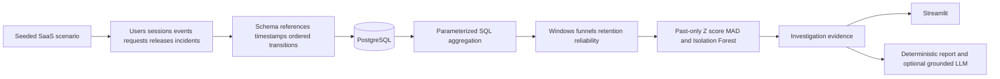

# Architecture and milestones

One Python application separates generation, validation, SQLAlchemy persistence,
SQL aggregation, product analytics, detection, investigation and reporting.
PostgreSQL is the deployment store; SQLite is the offline demonstration option.

1. Foundation: package, schema constraints and migrations; schema integration test.
2. Data pipeline: fixed-seed scenarios, validation, rejection audit and idempotent loading.
3. Analytics: explicit KPI denominators, ordered funnel, cohort maturity and labeled detection.
4. Investigation: before/after endpoint/segment/error evidence and nearby releases.
5. Presentation: six dashboard sections, shared date/segment filters and report export.
6. Verification: hand fixtures, defects, synthetic incident recall, UI and PostgreSQL tests.
7. Documentation and publication after checks; disclose unverified API/Compose capabilities.

Acceptance cases include duplicate IDs, bad references, naive/future timestamps, transitions,
empty denominators, immature retention cohorts, constant baselines and safe model fallback.
LLM facts are restricted to evidence IDs; raw event properties never reach the model.
